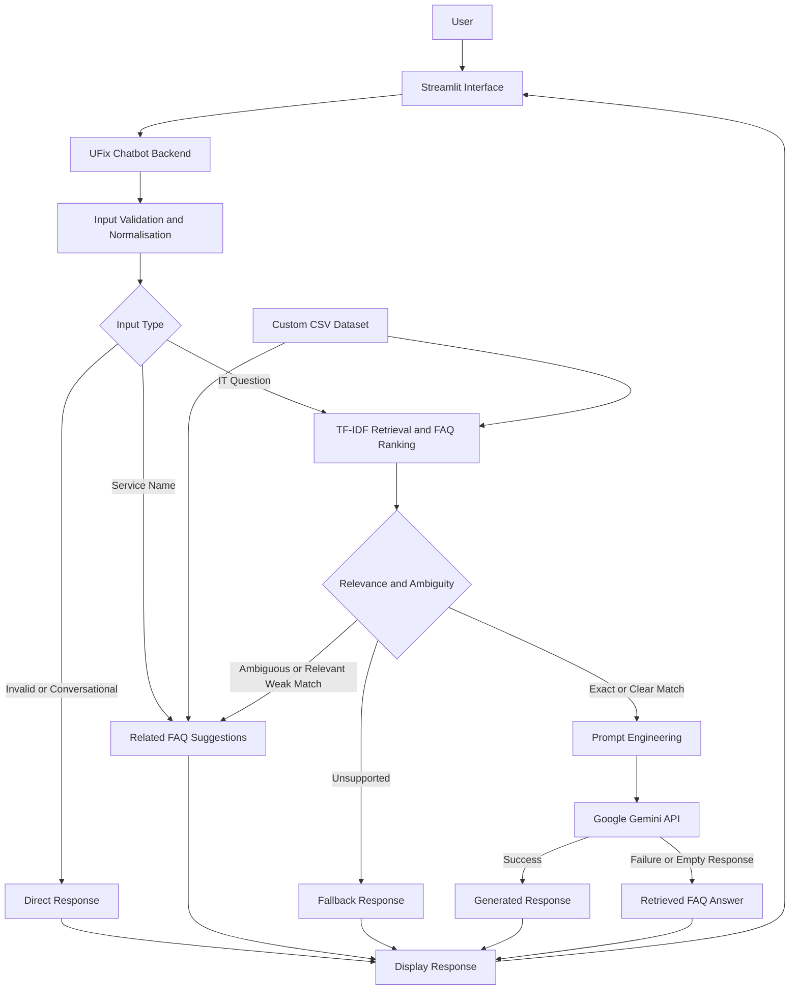

# UFix System Architecture

# 1. Architecture Overview

uFix combines a custom FAQ dataset, TF-IDF retrieval, prompt engineering, a large language model, and a Streamlit interface to answer UiTM IT helpdesk questions.

The system uses keyword normalisation, service recognition, ambiguity detection, and dynamic FAQ suggestions to keep responses relevant and consistent.

# 2. System Architecture Diagram

# 3. System Components

# Custom Dataset

- File: `data/it_faq.csv`
- Holds 48 Q&A pairs for the UiTM IT domain.
- Gives the chatbot its own knowledge base.
- Supplies related FAQ questions when clarification is needed.

# Retrieval Module

- File: `src/retrieval.py`
- Loads and validates the dataset with Pandas.
- Normalises FAQ questions and user inputs.
- Removes English stop words but keeps "not" and "no".
- Turns questions into TF-IDF vectors.
- Ranks FAQ matches with cosine similarity.
- Recognises supported IT service names.
- Detects ambiguity between competing FAQ matches.
- Suggests up to four related FAQ questions.

# Prompt Engineering

- File: `src/prompts.py`
- Sets the chatbot's identity, purpose, and rules.
- Adds the retrieved FAQ question and answer to the prompt.
- Tells the LLM to use only the FAQ context.
- Tells the LLM not to invent procedures, URLs, or university policies.
- Keeps important instructions and requirements from the FAQ.
- Tells the LLM not to ask for sensitive information.

# Chatbot Backend

- File: `src/chatbot.py`
- Validates user input.
- Handles greetings and acknowledgements.
- Works through ranked FAQ results.
- Checks relevance, confidence, and ambiguity.
- Gives dynamic FAQ suggestions for unclear questions.
- Calls the Google Gemini API for clear and relevant questions.
- Returns fallback responses for unsupported questions.
- Returns the original FAQ answer when the API fails or returns nothing.

# User Interface

- File: `app/app.py`
- Built with Streamlit.
- Accepts user questions.
- Shows chatbot replies.
- Keeps chat history for the current session.
- Displays common IT topics in the sidebar.
- Has a clear conversation button.
- Reminds users not to enter sensitive information.

# 4. Retrieval Decision Logic

- Empty or invalid input: return a validation message.
- Greetings and acknowledgements: return a direct conversational reply.
- Recognised service name: suggest related FAQ questions.
- Exact FAQ match: generate an answer with Gemini.
- Similarity 0.45 or higher: generate an answer if the question is clear enough.
- Similarity 0.25 to 0.44: ask for clarification and suggest related FAQs.
- Similarity below 0.25: return a fallback unless useful suggestions exist for short queries.
- Broad questions with two or fewer meaningful words: ask for clarification when a relevant match is found, except for exact FAQ matches.
- Competing FAQ matches: ask for clarification when the second highest score is at least 0.25 and the gap between the top two is under 0.10.
- API failure or empty response: return the original FAQ answer.

# Retrieval Parameters

- High confidence threshold: 0.45
- Low confidence threshold: 0.25
- Ambiguity margin: 0.10
- Adaptive suggestion factor: 0.6
- Maximum FAQ suggestions: 4

# LLM Configuration

- Provider: Google Gemini API
- Model: Gemini 3.5 Flash
- Model identifier: `gemini-3.5-flash`
- Temperature: 0.2
- Maximum output tokens: 1024

# 5. System Workflow

1. The user types a question into Streamlit.
2. The backend validates and normalises the input.
3. Greetings and acknowledgements get a direct reply.
4. Service names get related FAQ suggestions.
5. Other questions go through TF-IDF and cosine similarity.
6. The retrieval module ranks the closest FAQs.
7. The chatbot checks relevance, confidence, and ambiguity.
8. For clear matches, the FAQ is added to the Gemini prompt.
9. Gemini writes a domain specific reply.
10. Ambiguous questions get clarification and related FAQ suggestions.
11. Unsupported questions get a fallback reply.
12. If the API fails or returns nothing, the original FAQ answer is returned.
13. The final reply is shown in Streamlit.

# 6. Security and Privacy

- API keys are kept in a private `.env` file.
- The `.env` file is excluded from GitHub through `.gitignore`.
- The `.env.example` file holds placeholder settings without real keys.
- Users are told not to enter passwords or sensitive personal information.
- The prompt forbids asking for passwords, verification codes, or other sensitive information.
- API errors are logged without showing detailed exception information.
- The chatbot does not access or change university systems directly.

# 7. Architecture Limitations

- The knowledge base is limited to 48 Q&A pairs.
- TF-IDF matches words, not meaning.
- Spelling mistakes, abbreviations, and synonyms are not handled well.
- Retrieval is mainly built for English questions.
- FAQ suggestions may be incomplete or only loosely related.
- Similarity thresholds and ambiguity rules are set by hand.
- Chat history is shown but not sent to the model as context.
- Short follow ups like "yes" and "no" cannot be understood in context.
- The chatbot handles one question at a time.
- AI replies depend on the Gemini API. The FAQ fallback still works when the API is down.
- Gemini may give inaccurate information despite the prompt rules.
- Answer quality depends on the accuracy, relevance, and coverage of the FAQ dataset.

# 8. Future Improvements

- Add session based conversation memory.
- Move to semantic retrieval with embeddings.
- Improve spelling correction and abbreviation recognition.
- Improve multilingual retrieval for English and Malay.
- Support multiple questions in one message.
- Improve FAQ suggestion relevance and coverage.
- Expand and regularly update the custom FAQ dataset.